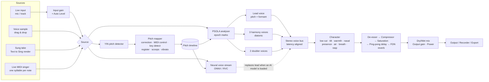

# VoxaVersa architecture

## Source tree

| Path | Responsibility |
|---|---|
| `Source/PluginProcessor.*` | Host integration, sources, MIDI, state, presets, offline render, recording, neural model lifecycle |
| `Source/PluginEditor.*`, `Source/ui/` | The user interface |
| `Source/Parameters.*` | Every automatable parameter (IDs are part of the saved-state format) |
| `Source/dsp/PitchDetector` | Streaming YIN on a ~16 kHz decimated signal, refined at full rate (≈2 cent accuracy), voicing hysteresis |
| `Source/dsp/PitchMapper` | Detected pitch → target pitch: scale-aware correction (retune speed, humanize, hysteresis), MIDI control, Krumhansl key detection, smart register (octave into the target voice's range), scoops, delayed vibrato, jitter |
| `Source/dsp/Psola` | Real-time TD-PSOLA. Analysis marks are pitch-synchronous epochs (peak-picked on an adaptive low-pass); synthesis grains are Hann-windowed two-period grains re-sampled by the formant ratio. Grain advance uses the *measured* epoch spacing so unshifted audio reconstructs almost perfectly. |
| `Source/dsp/VoiceChain` | Combines the above with harmony/doubler voices, the neural lead, character processing and FX; reports a constant latency |
| `Source/dsp/VocalFx` | Character EQ / breath / rasp, split-band de-esser, soft-knee compressor, ADAA saturation, tempo-synced ping-pong delay with ducking, 8-line FDN reverb, input AGC |
| `Source/voices/` | Voice profiles (`VoiceTraits` = everything the DSP needs), 46 factory voices, user voice packs, favourites |
| `Source/presets/` | Factory + user presets, A/B |
| `Source/sing/` | Text to Sing: lyrics parsing, G2P, melody generation/import, singing synthesiser, live MIDI singer |
| `Source/neural/` | ONNX Runtime loader and RVC-compatible voice conversion (offline + streaming) |
| `Source/core/AiDisclosure.h`, `Source/core/Watermark.*` | Marking of AI / synthetic vocals (EU AI Act Art. 50): metadata statement in every export, plus an inaudible spread-spectrum watermark on AI-voice and Text to Sing output (live and exported) with a detector |

## Latency

The DSP path needs to see a little of the future to place pitch-synchronous grains:

| Quality | Lowest tracked pitch | Latency @ 48 kHz |
|---|---|---|
| Low Latency | 80 Hz | ≈ 35 ms |
| Balanced | 60 Hz | ≈ 58 ms |
| High Quality | 52 Hz | ≈ 66 ms |

The plug-in reports its latency to the host, so DAW delay compensation keeps everything in time. Use
**Low Latency** while tracking/monitoring live. With an AI voice model loaded the latency grows by the
neural stream's chunk size (see `docs/NEURAL_ENGINE.md`). That suits mixing and offline rendering better than live monitoring.

## Real-time safety

- No locks, allocation or I/O on the audio thread. Shared data uses atomics, try-locked spin locks
  (keeping the previous value if busy) or lock-free FIFOs.
- Heavy work (voice-model loading, take rendering, offline export) runs on a `juce::ThreadPool`.
- Quality changes (which change latency) are applied on the message thread with `suspendProcessing`.

## How a voice is defined

A `VoiceProfile` carries metadata plus `VoiceTraits`: register (MIDI range), formant offset, tonal
shape (tilt, warmth, nasal, presence, air), breathiness, rasp, vibrato (rate/depth/onset), scoops,
jitter, and a genre production "vibe" (compression, de-essing, saturation, reverb, delay, doubling).
The UI's Gender / Age / Tone / Style knobs and the Intensity slider scale those traits. Voice packs
add an optional neural model so the timbre becomes that of a real trained voice.
